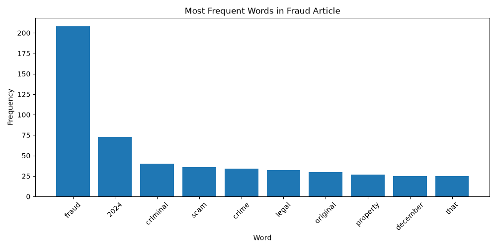

# Web Mining and Applied NLP Project Report

Web Mining and Applied NLP | Project 01 | Addie Gemmell

## Overview

This project analyzes text from the Wikipedia article about fraud to identify the words that appear most frequently.

The original project analyzed a Natural Language Processing article. I customized the project by changing the source to the Fraud Wikipedia article and then filtering out some unnecessary words that appeared in the results.

## Tools and Methods

The project uses:

- Python for text acquisition and analysis.
- Requests for retrieving HTML from web pages.
- BeautifulSoup for parsing HTML and extracting text.
- Polars for computing word frequencies.
- Matplotlib for frequency visualizations.
- WordCloud for visual exploration of vocabulary.
- Logging for execution records.
- Ruff, ty, and pytest for code verification.
- Zensical and GitHub Pages for published documentation.

The script retrieves text from the Fraud Wikipedia article, cleans the text, calculates word frequencies, and creates visualizations of the results.

## Small Technical Modification

For my first modification, I changed the source from the Natural Language Processing Wikipedia article to the Fraud Wikipedia article.

I predicted that words related to fraud, money, and financial activity would appear more frequently. The results showed that "fraud" was the most frequent word with 208 occurrences. Other common words included "criminal," "scam," "crime," and "legal."

The results also included unnecessary words such as "from," "retrieved," "with," and "archived." This showed that the webpage contained some text that was not useful to the analysis.

## Custom Application

For my custom application, I added filtering to remove the words "from," "with," "retrieved," and "archived."

Before the additional filtering, there were 5,490 cleaned words. After filtering, there were 5,326 cleaned words. Removing these words allowed more relevant terms to appear in the top results.

## Fraud Word Frequency Results

The final results show that "fraud" was the most frequent word with 208 occurrences. Other frequent terms included "criminal" with 40, "scam" with 36, "crime" with 34, and "legal" with 32.

## Interpretation

The results show that word frequency can provide a quick overview of the main terms used on a webpage. Filtering unnecessary words made the results more useful because fraud-related terms became more prominent.

One limitation is that the analysis uses only one Wikipedia article. The webpage also contains dates, references, and other text that can still affect the word counts.

If I continued this project, I would improve the text cleaning further or compare multiple fraud-related webpages to identify common terms across different sources.

## Documentation Index

- **Home** - this landing page
- [**Project Instructions**](project-instructions.md)
- [**Glossary**](glossary.md)

## Project Links

- [GitHub Repository](https://github.com/ajerineg-coder/nlp-01-getting-started-custom)
- [Custom Script](https://github.com/ajerineg-coder/nlp-01-getting-started-custom/blob/main/src/nlp/web_words.py)

## Project Resources

- [Project Instructions](project-instructions.md)
- [Professional Python Guide](https://denisecase.github.io/pro-analytics-02/)
- [Professional Python Project Explainer](https://pup-pack.github.io/professional-python-project-explainer/)
